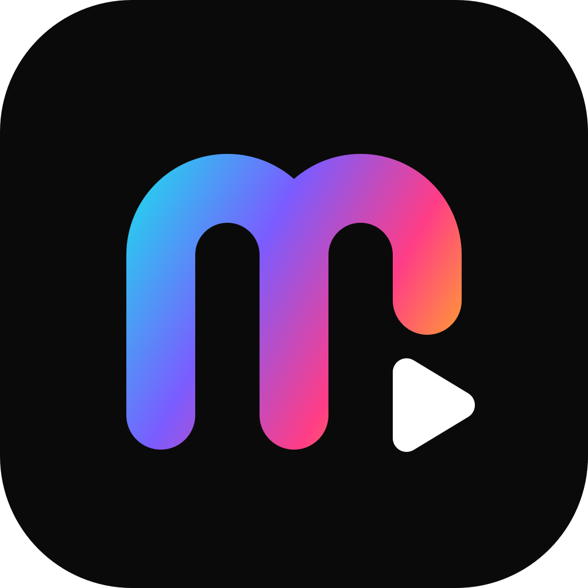

<div align="center">
  <h1><br>MinTube</h1>
  <p>An unofficial, open-source YouTube client for Android with a calm, redesigned interface.</p>

  <p>
    
    <a href="LICENSE"></a>
  </p>
</div>

**MinTube is a fork of [Litube](https://github.com/HydeYYHH/litube) 4.0.0 by HydeYYHH, licensed under GPL-3.0.**
The playback, extraction, download and account code is Litube's; MinTube changes the interface and the app identity.
MinTube is not affiliated with YouTube or Google, and it is not the upstream project: please do not report MinTube
issues to Litube.

## What MinTube changes

- **Redesigned interface.**
  - Every screen is rebuilt on one design system, with light and dark themes.
  - Colours: a cyan accent and true-grey neutrals. The dark theme uses the icon's black.
  - Type and icons: Be Vietnam Pro for titles and Material Symbols Rounded icons.
  - One shared navigation bar and one card family across feeds.
  - Every list has loading skeletons, plus empty and error states with a retry button.
  - The design plan is in [docs/UI_PLAN.md](docs/UI_PLAN.md).
- **Signature details.**
  - The played part of the seek bar is drawn in the icon's cyan-to-pink gradient. The bar is inset from the
    screen edges and lines up with the player controls.
  - A soft glow in the video's own colours sits behind the player. It can be turned off in Settings > Playback.
- **Phones and tablets.**
  - Phones stay in portrait. Only fullscreen video rotates.
  - Tablets rotate freely. In landscape they get a side navigation rail and a two-column watch page: the video and
    its details on the left, related videos on the right, and each column scrolls on its own.
  - The playing video stays pinned at the top while you scroll. A "now playing" strip with the title and channel
    appears under it once the title scrolls away, followed by a filter row for the related videos.
- **Content language and region.** Settings > General has "Translate titles to English" and "Trending in Vietnam" (both on by default); see [docs/CONTENT_LOCALE.md](docs/CONTENT_LOCALE.md).
- **Gestures.** Flick down on the video to minimize it, on phones and tablets. Brightness and volume swipes
  work only in fullscreen, so they never fight with minimizing.
- **Mini-player and picture-in-picture.**
  - Inside the app, the mini-player always sits at the bottom-right corner, above the navigation bar, and
    cannot be dragged around.
  - Leaving MinTube from any screen while a video plays turns it into a movable picture-in-picture window.
- **New name and application ID.** The app is `com.nevminhnh.mintube` (`com.nevminhnh.mintube.debug` for debug
  builds), so it installs side by side with Litube and never replaces it.
- **New icon.** A gradient "m" with a play mark. It is an adaptive launcher icon with a themed (monochrome) layer.
- **Fixes on top of Litube 4.0.0.** Remote search suggestions work again: the suggestion server wraps its
  reply in a JavaScript callback, which the bundled parser rejected. Channel avatars appear on the Home feed
  for signed-out users.
- **Its own update check.** The About screen points at the MinTube repository and links back to the original project.
- **Local testing.** All tests run on the developer machine and their results are committed with the code; GitHub
  Actions only builds and publishes releases (see *Tests and verification*).

Kept on purpose, so existing data keeps working: downloads are still saved under `Downloads/Litube`, and settings
backups keep the `litube-settings` format, so a Litube backup can be restored in MinTube.

## MinTube TV

MinTube TV is MinTube for Android TV and Google TV: a separate app with its own 10-foot interface, driven
entirely by the TV remote. It shares MinTube's player, SponsorBlock, DeArrow, account and data code, and is
released from the `tv` branch with `tv-v*` tags (for example `tv-v1.0.0`). Its application ID is
`com.nevminhnh.mintube.tv` and it is signed with the same key as MinTube, so it installs next to the phone app.

- **Screens:** Home rows by section plus a Shorts row, Search (keyboard, voice, suggestions, recent searches,
  filters), full-screen Watch, channel and playlist pages, Subscriptions, Library (History, Watch later,
  Playlists, Liked, Queue), full-screen Shorts and Settings.
- **Sign-in:** a device-code page shows a large code, the address to open and a QR code; finish on your phone.
- **Design:** dark only, cyan focus with a glow, overscan-safe margins, and focus that always comes back where
  you left it.

### Install

MinTube TV is not on the Play Store. Download `MinTube-TV-v<version>.apk` from the
[releases](../../releases) page and sideload it in one of two ways:

1. **Downloader app.** Install "Downloader" by AFTVnews from the TV's app store, allow it to install unknown apps
   (Settings > Apps > Security & restrictions > Unknown sources, or when Android TV asks), enter the APK's
   release URL and choose Install.
2. **USB or adb.** Copy the APK to a USB drive and open it with a file manager on the TV, or with developer
   options and network debugging on: `adb connect <tv-ip>` then `adb install MinTube-TV-v<version>.apk`.

MinTube TV then appears in the TV's app row. Check the file against the `.sha256` file published with it.

### Remote controls

| Where | Key | Action |
|---|---|---|
| Everywhere | D-pad | Move focus |
| | OK | Open or activate |
| | Back | Close the panel, then return to the menu, then leave |
| Menu rail | Left (from content) | Open the menu: Home, Search, Subscriptions, Library, Settings |
| | Refresh (bottom of the menu) | Reload Home and put focus on its first video |
| Home, Search | Hold OK on a video | Open its channel (when the feed names the channel) |
| Search | Mic button or remote's mic key | Voice search (when the TV has a recognizer) |
| | Hold OK on a recent search | Remove it |
| History | Hold OK on a video | Remove it from history |
| Watch | OK | Play or pause and show the controls |
| | Left / Right | Seek 10 s back or forward (hold to go faster) |
| | Up | Quality, speed, captions, audio track, chapters, Info, Like, Subscribe, Watch later |
| | Down | Up next (related videos) |
| | OK on the autoplay card / Back | Play the next video now / cancel autoplay |
| | Play/Pause, FF/RW, Next/Previous | Media keys work as expected |
| | Back | Hide the controls (the video keeps playing, or stays paused); with nothing on screen, leave |
| Shorts | Up / Down | Previous / next Short |
| | OK | Pause or play |
| | Left / Right | Seek 5 s |
| | Hold OK | Like |

### Limitations

- Sideload only; no Play Store listing and no in-app updates (watch this repository's releases).
- Not on TV: downloads, picture-in-picture, the mini player, comments and live chat.
- Voice search needs a speech recognizer on the TV.
- Hold OK on a Home card opens the channel only when the feed provides it; some signed-out feeds do not, and
  the card then just plays.
- Signing in, switching accounts and signed-in pages (Subscriptions, Liked, playlists) were not verified on a
  real account for this release.
- Casting from the YouTube phone app to MinTube TV is not supported. Share a YouTube link to the TV instead, or
  open the video in MinTube TV.
- Dark theme only. TV-only text is translated into Vietnamese; in other app languages it shows in English.

## Screenshots

Screenshots of every screen, light and dark, on phone and tablet, live in
[`docs/screens/`](docs/screens/) (see [`docs/screens/index.md`](docs/screens/index.md)). They were taken on the
emulator during QA; the QA results are in [`docs/QA_REPORT.md`](docs/QA_REPORT.md).

## Features

- **Browse YouTube.** Explore your home feed, search for videos, and browse channels, playlists, Shorts, and your library.
- **Play your way.** Enjoy ad-free playback with controls for video quality, speed, subtitles, and audio tracks. Keep listening in the background, use picture-in-picture or the mini-player, or cast to another device.
- **Download for later.** Save videos, audio, subtitles, or entire playlists. Choose the quality and language, and pause or resume downloads as needed.
- **Keep things organized.** Build queues with shuffle, repeat, and autoplay. Watch history and Watch later are available even when you're signed out.
- **Multiple accounts, all in one.** Easily switch between your anonymous account and multiple signed-in accounts.
- **Make it yours.** Customize SponsorBlock, playback gestures, themes, and language. Enable DeArrow for alternative titles and thumbnails.

**Requirements:** Android **7.0 / API 24** or later and an up-to-date **Android System WebView**. Picture-in-picture requires Android **8.0 / API 26** or later and a compatible device.

## Build from source

Use **JDK 21**, **Android SDK Platform 36**, and **Build Tools 36.0.0**. The repository includes a **Gradle 8.11.1** wrapper.

```sh
git clone https://github.com/nev-minhnh/MinTube.git
cd MinTube
```

Gradle downloads MediaServiceCore v1.0.0 from JitPack using the version pinned in `gradle/libs.versions.toml`.

Set `ANDROID_HOME` to your Android SDK directory, or set `sdk.dir` in an untracked `local.properties` file. Then build the debug APK:

```sh
./gradlew :app:assembleDebug
```

On Windows, replace `./gradlew` with `.\gradlew.bat` in these commands.

The debug APK is saved to `app/build/outputs/apk/debug/app-debug.apk`. Debug builds use the application ID `com.nevminhnh.mintube.debug`; release builds use `com.nevminhnh.mintube`. The Kotlin package and namespace remain `com.hhst.youtubelite`, as in Litube.

To build the release APK, run `./gradlew :app:assembleRelease`. The unsigned APK is saved to `app/build/outputs/apk/release/app-release-unsigned.apk`; sign it with your own release key before distribution. Signing material must never be committed.

<details>
<summary><strong>Tests and verification</strong></summary>

Run unit tests and Android lint checks:

```sh
./gradlew :app:testDebugUnitTest :app:lintDebug
```

Build the instrumented test APK:

```sh
./gradlew :app:assembleDebugAndroidTest
```

Instrumented tests use local fixtures by default. To run live-service read checks, pass `network=1` as an instrumentation runner argument.

MinTube runs every test locally. GitHub Actions only builds the APKs and publishes releases. `ci/local-test.sh` runs the unit tests, lint, the debug, release and R8 builds, and the offline emulator suite (`ci/device-suite.sh`). It writes the results to `test-results/<time>-<commit>/` (`SUMMARY.md`, JUnit XML, lint report, device suite output), and those results are committed with the code.

</details>

<details>
<summary><strong>Tech stack</strong></summary>

MinTube is built with **Kotlin**, Jetpack Compose / Material 3, **AndroidX Media3**, **coroutines / StateFlow**, **Koin**, **Room**, **WorkManager**, and **OkHttp**, all inherited from Litube.

Content and stream extraction are provided by the [MediaServiceCore fork maintained for Litube](https://github.com/HydeYYHH/MediaServiceCore).

</details>

## Contributing

Read [CONTRIBUTING.md](CONTRIBUTING.md) for the project structure, coding conventions, and validation steps, and [docs/ARCHITECTURE.md](docs/ARCHITECTURE.md) for the invariants a UI change must not break.

When reporting a bug, include your app version, device model, Android version, steps to reproduce the issue, and what you expected to happen. Describe what happened instead and attach a diagnostic archive if available (About > Export diagnostic logs).

## Acknowledgements

MinTube exists because of [Litube](https://github.com/HydeYYHH/litube) by HydeYYHH and its contributors: all of the app's functionality comes from that project.

Litube, and therefore MinTube, is built on a [fork of MediaServiceCore](https://github.com/HydeYYHH/MediaServiceCore), the YouTube engine used by [SmartTube](https://github.com/yuliskov/SmartTube), and inspired by [NewTube](https://github.com/aleixrodriala/newtube). Our thanks to the maintainers and contributors of these projects for the work, code, and ideas that make this app possible.

Parts of the Cast implementation are adapted from [NewTube](https://github.com/aleixrodriala/newtube), with the original license and attribution retained. The app also builds on AndroidX Media3 and the wider open-source Android ecosystem, with support for SponsorBlock and DeArrow.

Fonts and icons: Be Vietnam Pro (SIL Open Font License 1.1), Roboto and Material Symbols (Apache License 2.0). Their licence texts ship in `app/src/main/assets/`.

---

<p align="center">
  <strong>MinTube</strong> · a fork of Litube 4.0.0 · Licensed under the <a href="LICENSE">GNU GPL v3.0</a>
</p>
