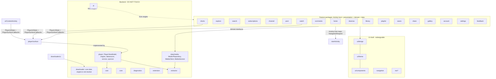

# MinTube / Litube 4.0.0 - Architecture for the UI redesign

Synthesis of survey reports `docs/_survey/01..06` (pristine Litube 4.0.0, GPL-3.0, commit `5fee29b`). Purpose: tell a UI rewriter what exists, what is a contract, and what must not move.

Conventions
- `J/` = `app/src/main/java/com/hhst/youtubelite/`. Every other path is repo-relative. `AT/` = `app/src/androidTest/java/com/hhst/youtubelite/`, `UT/` = `app/src/test/java/com/hhst/youtubelite/`.
- "Verified" = I opened the file or counted it myself while writing this document (section 9 lists every check). Claims copied from a report without re-opening are cited to the report and, where weak, tagged "unverified".

---

## 1. Overview

### 1.1 Stack and module
- One Gradle module `:app` (`settings.gradle.kts:29` `rootProject.name="litube"`; `include(":app")`). Kotlin 2.2.20, AGP 8.10.1, Compose BOM 2025.06.01, Media3 1.10.1, Room 2.8.4, Koin 4.1.0, WorkManager 2.10.5, OkHttp 4.12.0, coroutines 1.10.2 (`gradle/libs.versions.toml`, report 06 s1.1). JDK 17 target, CI builds on JDK 21.
- Kotlin namespace/package `com.hhst.youtubelite` (`app/build.gradle.kts:28`); `applicationId = "com.hhst.litube"` (`:32`) -> MinTube target `com.nevminhnh.mintube`. compileSdk/target 36, minSdk 24, versionCode 400 (`:29,33-36`).
- UI: Jetpack Compose with Material3 **plus** an in-house design system (`J/ui/design`, `J/ui/theme`, `J/ui/components`). Images come from the in-house `YoutubeThumb` over `core/YoutubeThumbnail` - **not Coil** (`coil-core` is declared at `app/build.gradle.kts:197` but only `J/core/YoutubeThumbnail.kt` references it; `J/ui/design/Artwork.kt:15` delegates to `YoutubeThumb`). Report 02 calling `Artwork` "a Coil wrapper" is wrong (verified).
- Backend: Koin (single module `J/di/AppModule.kt`, started in `J/App.kt`), `MediaClient`/`MediaSession` (YouTube InnerTube via the pinned `MediaServiceCore` fork from JitPack), Media3 `PlaybackEngine`, Room-based downloader, Cast V2 + DLNA.
- The only Koin `viewModel { }` is `DownloadViewModel` (`J/di/AppModule.kt:345`); everything else is a Koin `single` or built by an Activity-local `ViewModelProvider.Factory` (section 3.2).

### 1.2 Build types (`app/build.gradle.kts`, report 06 s1.3)
| Type | Lines | Notes |
|---|---|---|
| `release` | 53-60 | minify + shrinkResources; **no signingConfig** (unsigned APK) |
| `debug` | 61-65 | `.debug` suffix; adds `app/src/debug` activities (`PageReferenceActivity`, `LayoutReferenceActivity`, `PlayerTestActivity`, `ExtractionTestActivity`) and LeakCanary; the only type that honours fixtures |
| `minifiedDebug` | 66-73 | `initWith(release)`, debug-signed, `.minified`; R8 verification of reflection/serialization keep rules; swaps `androidTest` for `src/r8AndroidTest` when `-PandroidTestBuildType=minifiedDebug` (`:76-81`) |
No product flavors. `diagnosticBuildId` is a SHA-256 over every `src/main` file (`:17-25`): any UI edit changes BuildConfig and invalidates the configuration cache (expected, harmless).

### 1.3 Activity-per-screen navigation (no NavHost)
- There is **no Navigation-Compose**: `grep NavHost|NavController` over `J/` returns nothing (verified); `navigation-compose` is not in the build. Each screen is an `Activity` that calls `setAppContent { }` (31 matches incl. the definition, ~30 call sites) or `setContent { AppTheme {} }` (`J/ui/design/DesignTokens.kt`, report 01 s1).
- Base classes (report 01 s3.1): `NativeActivity : ComponentActivity` (`J/ui/NativeActivity.kt`: locale wrap, window background, system bars, open/close transitions, voice search, PiP suppression) -> `ContentActivity : NativeActivity` (`J/ui/ContentActivity.kt`: adds the mini-player overlay host) -> tab/browse Activities. `PlaybackActivity : NativeActivity` -> `WatchActivity`.
  - Extend `ContentActivity`: Home, You, Subscriptions, History, Playlists, Playlist, Channel, Explore, PostDetail, SearchResults.
  - Extend `NativeActivity`: SignIn, Settings, Advanced.
  - Plain `ComponentActivity`: Shorts (own black theme, no bottom bar), About, Gallery, Download*, TrafficVerification, ChatWebSignIn.
- ViewModels never start Activities. They emit a `*NavigationRequest` (BUFFERED `Channel` -> `Flow`) that the **Activity** maps to `startActivity`/share/queue/download/voice (e.g. `J/home/HomeActivity.kt` navigation handler, `J/channel/ChannelActivity.kt`). The comment in `HomeModels` says "New request types must be handled here" and several hosts use exhaustive `when` without `else` (`YouActivity`, `HistoryActivity`, `PlaylistsActivity`, `PlaylistActivity`) - report 04 s2.
- Deep links (`app/src/main/AndroidManifest.xml`): launcher `.home.HomeActivity` (`:61`, singleTop); exported `.navigation.ContentLinkActivity` (`:74`) handles https youtube hosts + `SEND text/plain`; Video/Short open `WatchActivity`/`ShortsActivity` directly (with a synthetic `HomeActivity(EXTRA_DEFER_HOME)` parent when task root, `J/navigation/ContentLinkActivity.kt:20-24`), every other link is forwarded to `HomeActivity` with the original intent (verified lines 20-24). `.downloader.ui.DownloadShareActivity` is a second `SEND` target. `ContentLink.parse` is security-sensitive (strict host/id regexes) and unit-tested (`UT/navigation/ContentLinkTest.kt`).

### 1.4 Tab switching
- `enum MainTab { Home, Shorts, Subscriptions, You }` at `J/ui/components/MainNavigation.kt:28` (report 01 says `:20`, wrong; verified). `MainTabs.tabs(signedIn, hideShorts)`: Subscriptions only when signed in; Shorts removed by the hide-Shorts pref.
- `MainTabs.intent(...)` builds an Intent with `FLAG_ACTIVITY_REORDER_TO_FRONT | FLAG_ACTIVITY_SINGLE_TOP` (`MainNavigation.kt:42-48`, verified; Shorts only reorders) plus extras `navigation_tab`, `navigation_tab_backward`. **Each tab is its own long-lived Activity brought to the front, not a back-stack push**; tab scroll/VM state survives because the Activity survives. Animations are XML `res/anim/navigation_tab_*` (direction aware) vs `navigation_detail_*` (10 files in `res/anim`, verified count; `anim-ldrtl` variant).
- Back: Home `BackHandler` closes overlay else `moveTaskToBack(true)` (`J/home/HomeActivity.kt:164`); You/Subscriptions `BackHandler` goes to Home (`J/library/YouActivity.kt:158`). `enableOnBackInvokedCallback=true`.
- The bottom bar is **four hand-copied implementations** + four destination enums (report 01 s3.2): `MainNavigationBar` (`ui/components/MainNavigation.kt`, You/Subscriptions), `BrowseNavigationBar` (`ui/design`, Channel/Playlist/PostDetail, never shows selection), inline `HomeBottomBar` in `HomeScreen`, `SearchNavigationBar` in `SearchResultsScreen` (uses `R.drawable.sample_bunny` as You avatar - placeholder in production). Tag format is a test contract: `"<tag>-navigation"` and `"<tag>-nav-<MainTab name>"`.
- Single-Activity/NavHost would lose per-tab retention and the XML transitions; reports 01/02 both recommend **keeping Activity-per-screen** and restyling in place.

### 1.5 Mini-player overlay host
`ContentActivity.onPostCreate` adds a `FrameLayout` + `ComposeView` on `android.R.id.content` of **every** ContentActivity (`J/ui/ContentActivity.kt`). It observes the singleton `PlaybackSession.player` and, when `uiState.visible && mini && !pip`, draws `MiniPlayerWindow(maxWidth.value.toInt(), 56, ...)` at `ContentActivity.kt:141` (verified): the literal `56` equals `DesignTokens.BottomBarHeight` and **must follow any bottom-bar height change** (also in `WatchActivity`, section 5). The overlay uses `com.hhst.youtubelite.ui.theme.AppTheme` directly (`ContentActivity.kt:139`, verified), not `ui.design.AppTheme`, so `LocalAppColors` there is the Light default (trap when re-theming). Browse -> Watch hand-off state lives in `J/navigation/WatchTransition.kt` (static mutable backdrop/artwork rects/PixelCopy frame).

---

## 2. Package map

Layer legend: **D** data, **Dm** domain (models, UiState, Action, NavigationRequest, repository interfaces), **P** presentation (ViewModel + Screen composables), **E** engine/infra, **UI** design system / shell, **H** Activity host (UI + wiring). Redesign column follows the project boundary: backend (data, domain, extractor, player engine, downloader engine, cast, core, diagnostics, di) = DO-NOT-TOUCH; presentation, `ui/design|theme|components`, resources, navigation = may change; Activities holding real side effects = RESTYLE-IN-PLACE (keep class + wiring, change composables passed to `setAppContent`).

| Package (`J/...`) | Lines / files | Layer split | MinTube redesign |
|---|---|---|---|
| `App.kt` | 98 | E (Koin start, `AppAppearance.update(prefs.themeMode())` at `App.kt:61`, runtime start) | DO-NOT-TOUCH |
| `di/` | 355 / 1 | E (`AppModule.kt`; `PlaybackApi` single `:243`, process-scoped `PlayerViewModel` single `:268`) | DO-NOT-TOUCH |
| `core/` | 1703 / 27 | E (`PreferenceStore`, `AppNotice`, `AppLocale`, `WriteFeedback`, `HapticsController`, `ContentSnapshots`, `YoutubeThumbnail`, `TrafficVerificationActivity`) | DO-NOT-TOUCH (visuals of `TrafficVerificationActivity` are WebView, leave) |
| `data/media/` | 4118 / 24 | D (`Media*Repository`, `MediaClient`, `MediaSession`, `LocalLibraryStore`, `ContentRepositories`) | DO-NOT-TOUCH |
| `extractor/` | 4238 / 29 | E | DO-NOT-TOUCH |
| `extension/` | 574 / 5 | D (settings store `ExtensionManager`, `PreferenceKeys`, `SettingsBackup`; `Extension.kt` catalog is test-only) | DO-NOT-TOUCH |
| `diagnostics/` | 1649 / 16 | E (no UI inside) | DO-NOT-TOUCH |
| `cast/` | 4802 / 22 | E (protocol, proxy, controllers; no Compose) | DO-NOT-TOUCH |
| `player/` engine part: `PlayerViewModel`, `engine`, `datasource`, `service`, `sponsor`, `QueueRepository`, `Playback*.kt` | ~15.5k / ~49 | E | DO-NOT-TOUCH |
| `player/PlaybackActivity.kt` (275) | H (PiP params/receiver/auto-enter) | RESTYLE-IN-PLACE (no visuals; keep) |
| `player/surface/` | 24 composable files ~6.5k | P (+ pure math `GestureMath`, `ZoomMath`; contract file `PlayerActions.kt`) | REWRITE-OK for composables; `PlayerActions.kt`, `PlayerWindowHost.kt`, `GestureMath.kt`, `MiniPlayerLayout.kt` DO-NOT-TOUCH (contract / behaviour / unit-tested); `MiniPlayerWindow.kt` RESTYLE-IN-PLACE (only `MiniPlayerChrome` + stroke/scrim constants) |
| `downloader/{core,data,engine,io,net,resolve}` | 7.6k / ~46 | E | DO-NOT-TOUCH |
| `downloader/ui/` | 3062 / 19 | P + H. `DownloadScreens/Sheets/Components/Tokens/Selection` = REWRITE-OK; `DownloadViewModel`, `DownloadUiState`/`DownloadUiMapper`, `DownloadPresentation`, `DownloadEntries`, `DownloadUi`, `DownloadActions`, `DownloadUiThrottle` DO-NOT-TOUCH (logic, unit-tested); Activities (`DownloadActivity`, `DownloadSheetActivity`, `DownloadShareActivity`) RESTYLE-IN-PLACE |
| `home/` | 2225 / 8 | Dm `domain/`, D `data/Fixture*` (debug fixtures), P `presentation/`, H `HomeActivity` | Dm/D: DO-NOT-TOUCH (incl. `HomeLayout` consts); `HomeViewModel` DO-NOT-TOUCH; Screen/FeedCards/Overlays/Previews REWRITE-OK; `HomeActivity` RESTYLE-IN-PLACE |
| `explore/` | 924 / 5 | same split; **`ExploreViewModel` lives inside `ExploreActivity.kt:49`** (verified; Activity class at `:304`) | VM DO-NOT-TOUCH, `ExploreScreen` REWRITE-OK, Activity RESTYLE-IN-PLACE |
| `search/` | 1869 / 8 | same split | `SearchResultsScreen`, `ChannelResultsList`, `ShortsResultsList` REWRITE-OK; VM/domain DO-NOT-TOUCH; Activity RESTYLE-IN-PLACE |
| `subscriptions/` | 1509 / 6 | same split | as above |
| `channel/` | 3315 / 10 | same split | as above |
| `post/` | 1408 / 11 | same split + `PostVotes.kt` (helper, keep) | as above; `PostCardActionsViewModel` DO-NOT-TOUCH |
| `watch/` | 4295 / 18 | Dm `domain/`, P `presentation/`, `chat/` (VM + panel), H `WatchActivity` (863, MIXED) | `WatchScreen`, `WatchDescription` (keep `parseDescription`/`timestampSeconds`), `LiveChatPanel`, previews REWRITE-OK; `WatchPlayer.kt`, `WatchPlayerState`, `WatchPageMotion`, `WatchFullscreenPull` DO-NOT-TOUCH; `WatchActivity` RESTYLE-IN-PLACE (keep layering, slot, hand-off); VMs and `WatchLayout` consts DO-NOT-TOUCH |
| `comments/` | 2605 / 11 | Dm, D fixture, P `CommentsViewModel` + `CommentsPanel` | `CommentsPanel`, `CommentRichBody`, `CommentSheetMotion` REWRITE-OK; VM/domain DO-NOT-TOUCH |
| `shorts/` | 2232 / 12 | Dm, P, H `ShortsActivity` (663, owns playback wiring), backend `ShortsMediaPreloader`/`ShortsEntryPreparation` | `ShortsScreen`, `ShortsDescriptionSheet`, `ShortPlaybackControls` REWRITE-OK; Activity RESTYLE-IN-PLACE; preloader DO-NOT-TOUCH |
| `dearrow/` | 337 / 2 | D `DeArrowService` (Koin single), P `DeArrowDisplay` | service DO-NOT-TOUCH; `DeArrowDisplay` REWRITE-OK (keep contract: original until replacement) |
| `library/` | 2493 / 9 | Dm, D fixture, P (3 VMs in `LibraryViewModels.kt`), H You/History/Playlists Activities | screens/components REWRITE-OK; VMs DO-NOT-TOUCH; Activities RESTYLE-IN-PLACE |
| `playlist/` | 1357 / 7 | same split; `PlaylistActivity` has real logic (batch download, queue handoff) | screens REWRITE-OK; Activity RESTYLE-IN-PLACE |
| `saves/` | 553 / 3 | Dm `SaveModels`, P `SaveSheetController` (plain class), `SaveSheets` composables | `SaveSheets` REWRITE-OK; controller/domain DO-NOT-TOUCH |
| `share/` | 143 / 3 | E-ish (`ShareGateway`, takes an `Activity`) | DO-NOT-TOUCH |
| `gallery/` | 298 / 2 | H + P (`GalleryActivity` composables) | RESTYLE-IN-PLACE (keep FileProvider authority) |
| `account/` | 697 / 7 | Dm, D `SignInService`, P `SignInViewModel`, `AccountMenuSheet`, H `SignInActivity`, `ChatWebSignInActivity` (plain Views) | sheets REWRITE-OK; VM/service DO-NOT-TOUCH; Activities RESTYLE-IN-PLACE |
| `settings/` | 670 / 6 | P screens, H Settings/AdvancedActivity | screens REWRITE-OK; Activities RESTYLE-IN-PLACE (listener lifecycle, theme/language apply) |
| `feedback/` | 33 / 1 | P `FeedbackSheet` (recommendation feedback, not bug reports) | REWRITE-OK (keep signature) |
| `navigation/` | 297 / 4 | `ContentLink` (security, DO-NOT-TOUCH), `ContentLinkActivity`, `ContentNavigation`, `WatchTransition` (player/PixelCopy coupled) | `ContentLink*`/`WatchTransition` DO-NOT-TOUCH; Intent factories RESTYLE-IN-PLACE |
| `ui/` root (`NativeActivity`, `ContentActivity`, `Notices`, `NoticeText`, `TransientMessage`, `YoutubeThumb`, `AccountChanges`, `ActivityMediaActionExecutor`) | ~1.1k | UI shell + logic | `NativeActivity`, `ContentActivity`, `AccountChanges`, `NoticeText` RESTYLE-IN-PLACE/DO-NOT-TOUCH logic; `TransientMessage` (raw View toast) REWRITE-OK |
| `ui/design/` | 19 files | UI | REWRITE-OK (visuals); gesture/physics files (`PullRefresh`, `GestureResistance`, `BottomSheetDrag`, `CollapsingAppBar`, `HapticAction`, `ContentPreferences`) RESTYLE-IN-PLACE (tuned by tests, read Koin directly) |
| `ui/theme/`, `ui/components/` | 6 + 7 files | UI | REWRITE-OK |
| `ui/about/`, `ui/extension/` | 3 + 1 | `AboutActivity` holds cache-clear/log-export/update-check logic; `SettingsDataScreen` holds SAF + backup validation | Activity logic DO-NOT-TOUCH, `AboutScreen` REWRITE-OK, `SettingsDataScreen` RESTYLE-IN-PLACE |
| `res/` (strings, drawables, anim, themes, mipmaps, 91 locale dirs) | - | resources | REWRITE-OK, but string keys are locked by `TranslationResourcesTest` (section 7) |
Note: `UT/browser`, `AT/browser`, `AT/batchd` exist as tests, but there is **no `J/browser` or `J/batchd` main package** (verified by `ls`).

Domain files contain presentation constants (`HomeLayout`, `SubscriptionsLayout`, `SearchResultsLayout`, `PostLayout`, `ChannelLayout`, `WatchLayout`, `CommentsLayout`, `PlaylistLayout`) and English labels on domain enums (`FeedMenuAction.label`, `WatchFeedbackKind`, `CommentMenuAction.label`, `HistoryMenuAction.label`, ...). They stay compiling and untouched; UI maps labels through `ui/design/LocalizedLabels.kt` (27 `labelResource` extension properties, report 01). `HomeUiState.chips = HomeLayout.chips` and `suggestions` are fixture-era defaults referenced by VMs (report 02 s5.1).

---

## 3. Data flow

### 3.1 Repository -> ViewModel -> UiState -> composable
1. Feature **domain interface** (`home/domain/HomeModels.kt`, `watch/domain/WatchModels.kt`, `library/data/LibraryRepository.kt`, ...) is implemented in `J/data/media/Media*Repository`, bundled by `ContentRepositories` (Koin single; lazy vals `home, search, watch, playlist, posts, channel, votes, videoActions, saves, library, subscriptions, explore, avatars, suggestions, shortsEntry, shorts(), comments(), localLibrary`).
2. The ViewModel holds `val uiState: StateFlow<XUiState>`, `fun onAction(XAction)`, `val navigationRequests: Flow<XNavigationRequest>`, usually `actionNotices: Flow<AppNotice>` and `writes: WriteFeedback`. State is an immutable sealed `content` (Loading | Ready/Feed | Empty | Failed ...) + overlay + flags. `SavedStateHandle` persists query, chip, tab, overlay, sort.
3. The Activity `collectAsStateWithLifecycle()` inside `setAppContent` and hands `(state, onAction)` to a **state-hoisted** `XScreen` composable. Composables never call repositories (exceptions: `AccountSwitch` in `YouActivity` reads `MediaSession` inline, `DownloadManagerScreen` handles intent mapping, `SettingsDataScreen` uses `koinInject`).
4. Navigation, share, queue, download, voice search, verification and chat-authorisation side effects are performed by the Activity from `navigationRequests`.

### 3.2 How ViewModels are constructed
- **Per-Activity `ViewModelProvider.Factory`**, not Koin. Example: `HomeActivity` builds `HomeViewModel(if (fixtures) FixtureHomeRepository(scenario) else sources.home, savedState, scenario, loadOnStart = !fixtures, saves, avatars, snapshots, accountKey, reportSignal, warm, ...)` with `null` for live-only collaborators in fixture mode (`J/home/HomeActivity.kt:103-117`, verified). `WatchActivity` builds `WatchViewModel`, `CommentsViewModel`, `LiveChatViewModel` the same way (`J/watch/WatchActivity.kt:165-196`, verified: `fixtures = ContentRepositories.fixtures(intent)` at `:165`, factories at `:173,:188`).
- **Fixture branch**: `ContentRepositories.fixtures(intent) = BuildConfig.DEBUG && (ContentSource.fixtures || intent marker)` (`J/data/media/ContentRepositories.kt:54`, verified). Debug builds under `ContentTestRunner` (`AT/ContentTestRunner.kt`, sets `ContentSource.fixtures = arguments["network"] != "1"`) run every Activity on `Fixture*Repository` + scenario extras (`EXTRA_SCENARIO`, `home_scenario`, `signed_in_preview`...). **The fixture branches share production code paths and all instrumented tests depend on them: keep them.**
- **Koin**: only `DownloadViewModel` via `koinViewModel()` (`J/di/AppModule.kt:345`). `PlayerViewModel` is a plain Koin `single` (process scope), **not** `viewModel {}`. Composables that read Koin directly: `rememberHideShorts()` (`ui/design/ContentPreferences.kt`, `GlobalContext.getOrNull()`), `HapticAction`, `SettingsDataScreen` (`koinInject`).
- Do not move VM creation into composables (`viewModel()`/`koinViewModel()`): the factories inject `signedIn`, fixtures, scenario, `SavedStateHandle` (`YouActivity` builds `YouViewModel(repository, SavedStateHandle, scenario, signedIn, saves)`, report 05 s7).
- The list of ViewModel classes in main (verified by grep): `SignInViewModel`, `ChannelViewModel`, `CommentsViewModel`, `DownloadViewModel`, `ExploreViewModel`, `HomeViewModel`, `YouViewModel`/`HistoryViewModel`/`CollectionViewModel`, `PlayerViewModel`, `PlaylistViewModel`, `PostCardActionsViewModel`, `PostDetailViewModel`, `SearchResultsViewModel`, `RecentCommentsViewModel`, `ShortsViewModel`, `SubscriptionsViewModel`, `LiveChatViewModel`, `WatchViewModel`. Settings, Advanced, About, Backup and the account switch have **no ViewModel**.

### 3.3 Account identity, session generation, private browsing
- `MediaSession` (global object, `J/data/media/MediaSession.kt`): `snapshot(): RequestContext` (`generation`, `signedIn`, `accountId`), `changes: StateFlow<MediaSessionIdentity(generation, signedIn)>` (`:89`), `accounts()`, `selectAccount`, `signOut()`, `completeSignIn`, `setAnonymousMode` ("On this device"). **Generation bumps on every identity change**; `MediaClient` re-checks generation per attempt and throws `MediaException(AUTH,"session_changed")` (report 05 s1).
- Propagation to UI: `ComponentActivity.observeAccountChanges(refresh: () -> Unit)` (`J/ui/AccountChanges.kt`, verified) collects `MediaSession.changes` under `repeatOnLifecycle(STARTED)`; each Activity's `refresh` calls `vm.updateSession(signedIn, generation/key)` (e.g. `HomeViewModel.updateSession` at `J/home/presentation/HomeViewModel.kt:129` bumps `sessionEpoch`/`scopeEpoch`, `writes.reset()`, cancels jobs). 23 `observeAccountChanges` matches in `J/` incl. definition (verified count). Every screen that shows account data needs this wiring, including new screens.
- UI also carries identity: `HomeScreen` compares `displayedSession != state.sessionGeneration` to reset scroll; `VideoMenu` renders feedback rows only if `video.feedbackGeneration == state.sessionGeneration`; `WatchVideo.sessionGeneration` / `WatchRelated.feedbackGeneration` pass through unchanged (reports 02, 03).
- **Private browsing**: persisted bool `PRIVATE_BROWSING` in `ExtensionManager`; `MediaSession.privateBrowsing()` (`MediaSession.kt:153`) is **polled** (not observed) by watch/resume reporting, `MediaSearchSuggestions.kt:71` (verified: `if (query.isBlank() || privateBrowsing()) return` blocks history write), `ContentRepositories` (Shorts entry disabled), `PlaybackEngine`, `ShortsMediaPreloader` (report 05 s1). **There is no UI indicator of private mode** (report 05: searched `incognito`/`privateBrowsing` in home/search/watch/ui - none). Existing history stays readable/removable (CONTRIBUTING).

### 3.4 Paging, refresh, loading conventions
- **Paging**: opaque `nextKey` strings; composable derives `nearEnd` from `LazyGridState/LazyListState.layoutInfo` (last visible >= total-3) and sends `AutomaticLoadNext`; VM caps empty pages (`emptyAutoLoads >= 3` -> automatic paging paused -> composable shows a "Load more" pill, tag `home-load-more`); consumed continuations are tracked to stop loops (`consumedContinuations`); append failure keeps rows (`AppendState.Failed` -> inline `RetryRow`). Explore also pages per shelf (`LoadShelf(index)`); History/Collection/Playlist use `ContinuationHistory` + `AppendState`; Playlist caps at `PlaylistLimits.MAX_ENTRIES=1000` (reports 02, 04).
- **Refresh**: custom (not Material3) `ui/design/PullRefresh.kt` (`rememberPullRefreshState`, `pullRefreshGesture`, `PullRefreshIndicator`, `RefreshableContent`). Only `userRefresh=true` should show the indicator; quiet refresh (`HomeViewModel.onForeground()` after 15 min or a watch-report signal) must not. A failed refresh keeps old rows + old pagination history (`refreshFailed`). Watch page has no pull-to-refresh (report 03).
- **Loading/empty/error**: sealed `*Content` in the VM; per-screen hand-built skeletons (`DesignTokens.Ghost` boxes, tags `*-skeleton`, `clearAndSetSemantics {}`); full-screen `Failed` + retry only when no content, else inline banner. Cold-start `ContentSnapshots` paints last Video rows on Home only.
- **Traffic challenge**: VM catches `MediaException` with `isTrafficChallenge()` -> `verification: VerificationRequired` -> `VerificationCard` (no content) / `VerificationBanner` (content), Activity launches `core/TrafficVerificationActivity` then calls `verificationCompleted(url)` (one retry).

### 3.5 Notices and errors
- `AppNotice` (`J/core/AppNotice.kt:9`, sealed): `SignIn`, `Message`, `LocalizedMessage`, `Failure(text, ActionFailureReport)`. VMs expose `actionNotices`; the Activity calls `renderNotice(AppNotice)` (`ui/Notices.kt`): `SignIn` -> `SignInFlow.open`, `Failure` -> framework `AlertDialog` with Copy-all (`appDialogContext()`).
- `Activity.showMessage(text)` is a raw framework `TextView` pinned to the decor (3 s or accessibility timeout) - **not a Snackbar** (`ui/TransientMessage.kt`).
- `ui/NoticeText.kt` maps ~60 **English literal strings** emitted by VMs/domain to string resources; if a backend string changes, translation silently falls back to English (report 01 s2.7/s9). Do not edit those backend strings.
- Write progress: `WriteFeedback` (`J/core/WriteFeedback.kt:12`) rendered by `WriteProgressOverlay`/`ActionProgress`; reset on session change.
- Playback failures/cast failures have their own copyable reports (`PlaybackFailureDialog`, `CastFailureDialog`, section 4). `SignInViewModel` error messages are English-only (`SignInUiState.Error(message)`, report 05 s9).

---

## 4. Screen -> ViewModel table

Hosts and files under `J/`. "Domain" = interface the VM calls. Fixture repos omitted. `NavReq` = `*NavigationRequest` handled by the host Activity. Types in report order; names verified by grep where the VM class exists.

| # | Screen / sheet / dialog | UI file(s) | Host Activity | ViewModel / state holder | UiState | Action / intent | Domain / repository called |
|---|---|---|---|---|---|---|---|
| 1 | Home feed, chips, top/bottom bar, skeleton/empty/error | `home/presentation/HomeScreen.kt`, `FeedCards.kt` | `home/HomeActivity` | `HomeViewModel` (`HomeViewModel.kt`) | `HomeUiState` (`content: HomeContent`, `overlay: HomeOverlay`) | `HomeAction` (OpenSearch, SelectChip, Refresh, LoadNext/AutomaticLoadNext, OpenMenu, Save*, ...) + `HomeNavigationRequest` | `HomeRepository.loadHome/menu/feedback/filters`, `SaveRepository`, `MediaAvatarDirectory`, `ContentSnapshots` |
| 2 | Home search overlay (shared `SearchPanel`) | `home/presentation/HomeOverlays.kt` + `ui/design/SearchPanel.kt` | HomeActivity | HomeViewModel (`overlay=Search`) + `rememberSearchRows` | `HomeOverlay.Search`, `SearchRows` | `QueryChanged`, `SubmitSearch`, `VoiceSearch` | `MediaSearchSuggestions.rows` (`data/media`) |
| 3 | Video / Mix menu, Save-to-playlist, New playlist, Feedback sheet | `HomeOverlays.kt`, `saves/presentation/SaveSheets.kt`, `feedback/presentation/FeedbackSheet.kt` | HomeActivity | HomeViewModel | `HomeOverlay.Menu/Save/Feedback` | `MenuSelected`, `SaveDestinationSelected`, `SaveChoiceToggled`, `SubmitNewPlaylist`, `FeedbackReason` | `HomeRepository.menu/feedback`, `SaveRepository.choices/setContaining/create` |
| 4 | Explore (category chips, shelves) | `explore/presentation/ExploreScreen.kt` | `explore/ExploreActivity` | `ExploreViewModel` (in `ExploreActivity.kt:49`) | `ExploreUiState` | `ExploreAction` (SelectCategory, LoadShelf, LoadMore, Retry, ...) | `ExploreRepository.explore/exploreNext/exploreShelf` |
| 5 | Search results (filters, list, channels, shorts, playlists) | `search/presentation/SearchResultsScreen.kt`, `ChannelResultsList.kt`, `ShortsResultsList.kt`; playlist rows `playlist/presentation/PlaylistSearchList` | `search/SearchResultsActivity` | `SearchResultsViewModel` | `SearchUiState` (`filters: SearchFilters(type, uploaded)`) | `SearchAction` (VisibleResults, SelectResultType, SelectUploadDate, Subscribe, OpenItemMenu, LoadMore, ...) | `SearchRepository.search/next/metadata/menu/feedback`, `VideoActions.subscribe`, `SaveRepository` via `saveSheet` |
| 6 | Search input overlay (suggestions, history, voice) | `ui/design/SearchPanel.kt`, `ui/components/SearchRows.kt` | Home / Search / Subscriptions / You / History / Playlists / Watch hosts | owning screen VM + `rememberSearchRows` | `SearchRows` | `onQueryChanged/onSubmit/onVoiceSearch/onRemoveHistory` | `MediaSearchSuggestions`, `PreferenceSearchHistoryStore` |
| 7 | Subscriptions feed, avatar strip, channels overlay | `subscriptions/presentation/SubscriptionsScreen.kt` | `subscriptions/SubscriptionsActivity` | `SubscriptionsViewModel` | `SubscriptionsUiState` (`content: Loading/SignedOut/Feed/Failed`, `channels`) | `SubscriptionsAction` (SelectChip, ShowChannels, SelectChannel, SignIn, Manage, ...) | `SubscriptionsRepository.subscriptions/channelSubscriptions/subscribedChannelsPage/menu/feedback/supportedFilters` |
| 8 | Channel (header, 7 tabs, About panel, menus, in-channel search) | `channel/presentation/ChannelScreen.kt`, `ChannelCommunityTabs.kt`, `ChannelAboutPanel.kt`, `ChannelSearchTab.kt` | `channel/ChannelActivity` | `ChannelViewModel` | `ChannelUiState` (`ChannelSection<T>` per tab) | `ChannelAction` (SelectTab, Subscribe, Sort*, Load*Next, RetrySection, ...) | `ChannelRepository.channel/videos/shorts/live/posts/playlists/searchVideos/...`, `VideoActions.subscribe` |
| 9 | Post detail (carousel, image viewer, poll, comments teaser) | `post/presentation/PostDetailScreen.kt`, `PostImageCarousel.kt`, `PostImageViewer.kt`, `PostPollChoices.kt` | `post/PostDetailActivity` | `PostDetailViewModel` (+ `CommentsViewModel`) | `PostDetailUiState` | `PostDetailAction` (Like, Dislike, Vote, OpenImage, Comments, ...) | `PostRepository.post`, `PostActions.rate/vote` (cast of the same repo), `CommentsRepository` |
| 10 | Feed/channel post card actions | `post/PostVotes.kt` (`PostCardActionHost`) | Home / Channel hosts | `PostCardActionsViewModel` | `PostCardInteractions` | `onAction(identity, PostDetailAction)` | `PostActions` |
| 11 | Post image gallery | `gallery/GalleryActivity.kt`, `GalleryImages.kt` | `GalleryActivity` (only caller: post) | none | local | save/share image | FileProvider `${packageName}.download.fileprovider` |
| 12 | Watch page (metadata, actions, related feeds, comments teaser) | `watch/presentation/WatchScreen.kt`, `WatchDescription.kt` | `watch/WatchActivity` (863 lines, mixed) | `WatchViewModel` | `WatchUiState` (`content: Loading/Ready/Failed`, `overlay`, `commentsOpen`) | `WatchAction` (Like, Dislike, Subscribe, Download, Queue, Save, OpenComments, LoadRelated, SeekToTimestamp, ...) + `WatchNavigationRequest` | `WatchRepository.watch/watchFresh/next/menu/feedback`, `VideoActions.rate/subscribe`, `VoteCountRepository.counts`, `SaveRepository` |
| 13 | Watch item menu / Save / Feedback sheets | `WatchScreen.kt:161` `WatchVideoMenu`, `SaveSheets.kt`, `FeedbackSheet.kt` | WatchActivity | WatchViewModel (`WatchOverlay.ItemMenu/Save/Feedback`) | same | `OpenItemMenu`, `MenuAction`, `FeedbackReason`, `Save*` | as above |
| 14 | Comments panel (Watch) | `comments/presentation/CommentsPanel.kt`, `CommentSheetMotion.kt` | WatchActivity (`comments-panel-host`) | `CommentsViewModel` | `CommentsUiState` (`content`, `overlay`, `draft`, ...) | `CommentAction` (LoadMore, SelectSort, Compose, SubmitDraft, LikeThread, Reply, ...) | `CommentsRepository.comments/repliesPage`, `CommentActions.perform` (`repository as? CommentActions`, `CommentsViewModel.kt:104` per report 03) |
| 15 | Comments (Post, Shorts) | `CommentsPanel.kt` | PostDetailActivity (`:105-115`), ShortsActivity (`:472`) | `CommentsViewModel`; Shorts via `RecentCommentsViewModel.getOrCreate` | same | same | same |
| 16 | Live chat panel (rail/sheet) | `watch/chat/LiveChatPanel.kt` | WatchActivity (`:202-209`) | `LiveChatViewModel` (+ `LiveChatRouting.liveChatTarget`) | `LiveChatUiState` | `DraftChanged, Send, Retry, SignIn` | `LiveChatGateway.listen/replay/send`, `ChatWebSessionStore` |
| 17 | Player surface (controls, gestures, overlays, subtitles, sponsor card) | `player/surface/PlayerSurface.kt`, `PlayerControls.kt`, `PlayerTimeBar.kt`, `PlayerGestures.kt`, `PlayerGestureOverlays.kt`, `SubtitleOverlay.kt` | Watch / Shorts / ContentActivity mini via `watch/presentation/WatchPlayer.kt` | `PlayerViewModel` (process singleton, `PlayerViewModel.kt`) | `PlayerUiState` (`:167`) + out-of-state `positionState`, `bufferedPositionState`, `gestureState`, `hintState`, `subtitleCuesState` | `PlayerPlaybackActions` + `PlayerWindowActions` (`player/surface/PlayerActions.kt:10,79`) | `PlaybackApi` (`PlaybackEngine`), `QueueRepository`, `SponsorBlockManager`, `CastController`, `DlnaController` |
| 18 | Player sheets/dialogs: More, Queue, Chapters, SubtitleStyle; Quality, Speed, EndBehavior, Resize, Audio, Captions, Info; anchor menus; segment preview | `PlayerSheets.kt`, `QueueSheet.kt`, `LibraryQueueSheet.kt`, `ChaptersSheet.kt`, `SubtitleStyleEditor.kt`, `AnchorMenus.kt`, `InfoDialog.kt`, `PlayerModalDialog.kt`, `FullscreenPlayerSheet.kt` | via PlayerSurface | PlayerViewModel | PlayerUiState | `onQuality/onSpeed/onLoopMode/onQueue*/onSubtitle*/onAudioTrack/onResize` | `PlaybackApi`, `QueueRepository` |
| 19 | Mini player (Watch overlay and browse overlay) | `player/surface/MiniPlayerWindow.kt` (980), `MiniPlayerChrome` in `PlayerControls.kt:620` | WatchActivity `:558`, `ui/ContentActivity.kt:141`, `library/YouActivity` ref | PlayerViewModel; geometry in `MiniPlayerStore` | `PlayerUiState.mini/visible/fullscreen` | `onMiniClose/onMiniRestore/onMiniSwipeRequested/enterMiniPlayer` | `MiniPlayerStore` prefs |
| 20 | Shorts pager, rail, description sheet, playback order dialog | `shorts/presentation/ShortsScreen.kt`, `ShortPlaybackControls.kt`, `ShortsDescriptionSheet.kt` | `shorts/ShortsActivity` (663) | `ShortsViewModel` (+ shared `PlayerViewModel`) | `ShortsUiState` | `ShortsAction` (Like, Dislike, OpenComments, Subscribe, OpenSaveToPlaylist, ...) | `ShortsRepository.shorts/shortsNext/hydrate`, `VideoActions`, `SaveRepository` via `saveSheet` |
| 21 | You tab (library rows, history/playlists shelves, account) | `library/presentation/YouScreen.kt`, `LibraryComponents.kt` | `library/YouActivity` (346) | `YouViewModel` (`LibraryViewModels.kt:53`) | `LibraryUiState` | `LibraryAction` + `LibraryNavigationRequest` (17 types) | `LibraryRepository.you()`, `removeFromHistory/restoreHistoryEntry`, `SaveRepository` |
| 22 | History (list, manage sheet, undo banner, clear confirm) | `YouScreen.kt` `HistoryScreen` | `library/HistoryActivity` | `HistoryViewModel` (`:353`) | `HistoryUiState` | `LibraryAction` (LoadHistoryNext, PauseHistory, ConfirmClearHistory, UndoHistoryRemove, ...) | `LibraryRepository.history/historyNext/removeFromHistory/setHistoryPaused/clearHistory` |
| 23 | Playlists list | `YouScreen.kt` `CollectionScreen` | `library/PlaylistsActivity` | `CollectionViewModel` (`:721`) | `CollectionUiState` | `LibraryAction.LoadCollectionNext/OpenPlaylist` | `LibraryRepository.playlists/playlistsNext` |
| 24 | Playlist detail (hero, menu, entry menu) | `playlist/presentation/PlaylistScreen.kt`, `PlaylistCards.kt` | `playlist/PlaylistActivity` (223, batch/queue logic) | `PlaylistViewModel` | `PlaylistUiState` | `PlaylistAction` (PlayAll, Shuffle, Download, Save, ...) + `PlaylistNavigationRequest` | `PlaylistRepository.playlist/playlistNext`, `SaveSheetController.savePlaylistToLibrary`, `DownloadUi.showBatchConfirm` |
| 25 | Save-to-playlist / New-playlist sheets (shared) | `saves/presentation/SaveSheets.kt` | You, History, Playlist, Search, Shorts, Subscriptions hosts (Watch and Home keep their own overlay copies) | `SaveSheetController` (plain class owned by the host VM) | `StateFlow<SaveSheetState?>` | `open/dismiss/toggle/retry/openNewPlaylist/submitNewPlaylist/saveWatchLater` | `SaveRepository.choices/setContaining/saveWatchLater/create/savePlaylistToLibrary` |
| 26 | Download manager (list/batch/settings/history panes, delete dialog) | `downloader/ui/DownloadScreens.kt`, `DownloadComponents.kt` | `downloader/ui/DownloadActivity` | `DownloadViewModel` (Koin) | flows `observeDownloads/observeBatch/observeVideo` -> `DownloadItemUiState`; local `DownloadDest` | `pause/resume/cancel/retryFailed/redownload/remove/clearHistory`, prefs setters | `DownloadCoordinator` |
| 27 | Download confirm sheets (single, batch) | `DownloadSheets.kt`, `DownloadSelection.kt` | `DownloadSheetActivity` (translucent `Theme.App.DownloadSheet`) | `DownloadViewModel` | local `rememberSaveable` fields + `CatalogState`/`PreviewState` | `loadCatalog/preview/confirmSingle/confirmBatch/validateSnapshot` | `DownloadCatalogSource`, `DownloadCoordinator` |
| 28 | Share-intent / notification entries | - | `DownloadShareActivity`, `DownloadActionActivity`/receiver | none | - | parse via `DownloadShareParser` | - |
| 29 | Share (video/playlist/channel link, open with, copy) | no UI of its own | each host Activity | `ShareGateway` (takes an `Activity`), `ActivityMediaActionExecutor` | - | `share/sharePlaylist/shareChannel/openWith/copyLink` | `VideoShare`, `PlaylistShare` (accepts only `PL...` ids) |
| 30 | Sign-in (device code) | `account/SignInActivity.kt` | `SignInActivity` | `SignInViewModel` (in-Activity) | `SignInUiState` | `SignInAction.Retry` | `SignInService.loadCode/poll/complete` -> `MediaSession` |
| 31 | Account menu / switch / sign-out confirm | `account/presentation/AccountMenuSheet.kt` | `library/YouActivity` | `YouViewModel` (menu); **no VM** for switch sheet and sign-out dialog (Activity-local state) | `LibraryOverlay.Account`, `AccountItem` | `LibraryAction.OpenAccountMenu/AccountSelected(AccountMenuAction)` | `MediaSession.accounts/selectAccount/setAnonymousMode/signOut` |
| 32 | Chat/post web authorisation | `account/ChatWebSignInActivity.kt` (plain Views) | same | none | - | `EXTRA_POST_AUTHORIZATION` | `MediaSession.snapshot`, `ChatWebSessionStore` |
| 33 | Settings (Home/General/Playback/Notifications pages, theme and language dialogs) | `settings/presentation/SettingsScreen.kt`, `SettingsRows.kt` | `settings/SettingsActivity` | none (reads `ExtensionManager` snapshot map) | `Map<String,Boolean>` + saveable `SettingsPage` | callbacks `onToggle/onSelectTheme/onSelectLanguage/onNavigate/onAbout/onAdvanced` | `ExtensionManager`, `AppAppearance.update`, `AppLocale.apply` |
| 34 | Advanced settings (gestures, SponsorBlock, DeArrow, player, haptics) | `settings/presentation/AdvancedScreen.kt` | `settings/AdvancedActivity` | `HapticsSettings` holder | prefs map | `onToggle`, `onGestureChange(Map)` -> `importPreferences` (two keys atomically) | `ExtensionManager` |
| 35 | Backup / restore | `ui/extension/SettingsDataScreen.kt` | `AdvancedActivity` (`data` flag) | none (local `remember`, `koinInject`) | local | SAF `CreateDocument`/`OpenDocument` | `SettingsBackup.export/parse/apply`, `AppLog.operation` |
| 36 | About / update check / log export / clear cache | `ui/about/AboutScreen.kt` | `ui/about/AboutActivity` (logic inside) | none (`action{}` busy helper) | status string | rows Source, Check update, Releases, Clear cache, Export logs, Save logs | OkHttp GET `AboutActivity.kt:87`, `AppLog.export`, cache owners |
| 37 | Cast device picker | `player/surface/PlayerCastDialog.kt` (`CastDialog`) | via PlayerSurface | PlayerViewModel | `casting, castDevices, castLinkUrl, castLinkConnected` in `PlayerUiState` | `onCastDevice/onCastStop/onCastDiscovery(enabled)/onShareCastLink` | `CastController`, `DlnaController` |
| 38 | Cast status banner, cast / playback failure dialogs | `PlayerControls.kt:483` `CastStatusBanners`, `CastFailureDialog.kt`, `PlaybackFailureDialog.kt` | via PlayerSurface | PlayerViewModel | `castFailure`, `failureReport`, `failureDialogVisible` | `onCastFailureDismiss`, `onRetry`, `onErrorDetails`, `dismissPlaybackFailure` | `CastFailureReport`, `PlaybackFailureReport` |
| 39 | Traffic verification card/banner | `ui/design/VerificationCard.kt`; Activity `core/TrafficVerificationActivity` | every browse host | each VM's `verification` field | `VerificationRequired` | `DismissVerification`, `OpenVerification` | `MediaException.failure.isTrafficChallenge()` |
| 40 | Notices (SignIn, failure-report dialog, toast) | `ui/Notices.kt`, `NoticeText.kt`, `TransientMessage.kt` | any Activity via `renderNotice` | VM `actionNotices` | `AppNotice` | - | `SignInFlow`, `ActionFailureReport` |

---

## 5. Player ownership and continuity - invariants a UI rewriter must not break

Ownership (reports 03 s5, verified where noted)
- **One engine, one controller**: `PlaybackApi` = `PlaybackEngine` (Koin `single`, `J/di/AppModule.kt:243`) wrapped by **one process-scoped `PlayerViewModel`** (Koin `single`, `AppModule.kt:268`, comment "Process-scoped: background play, MediaSession keys and queue auto-advance must outlive the activity"). `PlaybackSession.register(player)` publishes it; `PlaybackService` (Media3 `MediaSession`) serves media keys/notification. Watch, Shorts, mini player and PiP are all **views** of that singleton; UI = observers + callers of `PlayerPlaybackActions`, never an owner.
- **Seam**: `PlayerUiState` (state out, `PlayerViewModel.kt:167`) and `PlayerSurfaceCallbacks = PlayerPlaybackActions + PlayerWindowActions` (`J/player/surface/PlayerActions.kt:10,79`; verified). `PlayerViewModel` **implements** the UI-package interface, so moving/renaming `PlayerActions.kt` breaks the engine side. High-rate values (`positionState`, `bufferedPositionState`, `gestureState`, `hintState`, `subtitleCuesState`) are deliberately outside `PlayerUiState` for performance; do not merge them back. Gesture pref gating is `PlayerViewModel.gestureEnabled(zone)` (`:241`, verified) - keep it.
- **One SurfaceView**: created in `PlayerSurface`; `WatchPlayer` attaches on ON_START/ON_RESUME and detaches on ON_STOP/dispose (`J/watch/presentation/WatchPlayer.kt:60-74,120-123` calling `PlayerViewModel.attachSurface/detachSurface`, `:1509,:1519`; verified) and calls `initializeCast()` (`WatchPlayer.kt:105`, verified). `PlaybackLifecycle` hides video 700 ms after the last Activity stops.

Invariants
1. **Never create a second `PlayerSurface`/`SurfaceView` per mode.** `WatchActivity` keeps ONE `MiniPlayerWindow` (`J/watch/WatchActivity.kt:558`, verified) whose content is `WatchPlayer`; it interpolates between the page's slot rect, fullscreen, and mini. Source comment `WatchActivity.kt:516`: "a mode switch keeps the composition, the SurfaceView and the prepared media".
2. **The page must expose a player-slot Box and keep reporting its `boundsInRoot`**: `playerSlot = { Box(slotModifier.onGloballyPositioned { playerSlotBounds.value = it.boundsInRoot() }) }` at `WatchActivity.kt:538-539` (verified; report 03 cites 524-526, wrong) with `keepPlayerSlotInFullscreen = true` (`:543`). Without it the player cannot follow the layout. Test tags `watch-player-slot`, `player-window` (34 test uses) depend on it.
3. **Mini-player dock**: the browse-side host is `ContentActivity.kt:141` with hard-coded bottom offset `56`; `WatchActivity` must use the same value or the hand-off jumps (report 03 risk 7: `WatchActivity.kt:~538-546`, unverified exact lines). A new bottom-bar height must update both. Mini geometry persists via `MiniPlayerStore` prefs (`mini_player_width_dp`, `_translation_x_dp`, `_y_dp`). Mini controls are 30/34 dp (`MiniPlayerLayout.CONTROL_SIDE_DP/PLAY_DP`) - below 48 dp but test-pinned.
4. **Hand-off Watch -> mini**: swipe down -> `onMiniSwipeRequested` -> `PlayerUiState.mini=true` -> `onMiniSwipeFinished` -> `prepareWindowHandoff { finish() }` finishes `WatchActivity`; the mini then lives in `ContentActivity` at `WatchTransition.miniBounds`, restored by `onMiniRestore`/tap with a captured frame (`WatchTransition.videoFrame/miniRestoreFrame`, PixelCopy) to avoid a black flash (`WatchActivity.handoffToMini` `:751-815` per report). Keep `miniHandoffPending/localMiniCollapse`, `withWatchPresentation` merge (hand-off overrides only `visible/mini/fullscreen`), and the `entryProgress/playerDrawn` gate (page alpha tied to the player's first draw via `watchPageContent { alpha }` only; layout must be final from frame 0).
5. **Layer order in `WatchActivity` is touch routing**: backdrop -> page -> overlay player -> search -> comments/chat -> item menu. Back order: overlay -> search -> comments overlay -> comments -> `PlayerUi.nextBackStep(locked, fullscreen)`. Comments and item overlays auto-close on fullscreen/PiP. Covered layers use `clearAndSetSemantics {}` so tests/a11y see only the top layer.
6. **PiP** is `PlaybackActivity` (`pipParams()`, API 31+ auto-enter, `onUserLeaveHint`, remote actions prev/play/next/audio, `inPip` StateFlow); `WatchActivity` treats `fullscreen = playerState.fullscreen || pip`; `PlayerSurface(pip=true)` fills the window; `onPipEntered/onPipDismissed` must be called. Keep `PlayerWindowEffects` (immersive bars, orientation lock) and `PlayerWindowHost` brightness/volume.
7. **Contract types a rewriter keeps stable**: `PlayerUiState` fields, `PlayerPlaybackActions`/`PlayerWindowActions` members, `GestureCallbacks` + `GestureMath` (unit-tested `GestureMathTest`), `FullscreenSwipeHandle`/`MiniPlayerHandle` (`MiniPlayerWindow.kt:101,118`), `SideEffect` writing `pictureAspectRatio/pictureResizeMode` in `PlayerSurface.kt:112-118` (required by the window morph), `onQueueMove(from,to,owner)` with the `QueueOwner` captured at drag start (`QueueDragState`; commit from a switched identity is dropped).
8. **Cast discovery gating**: the picker polls `onRefresh` every 1.5 s and enables discovery only while open (`onCastDiscovery(true/false)`, `DisposableEffect`/`LaunchedEffect` in `PlayerCastDialog.kt`) - behaviour, not visuals (battery).
9. **Net-new features need backend work**, out of UI-only scope: sleep timer, seek-bar storyboard preview, in-queue shuffle toggle, in-app offline playback of downloads (reports 03/04).

---

## 6. Contract invariants from CONTRIBUTING.md that presentation code can violate

(`CONTRIBUTING.md` read in full by me; examples are from report 05 s7 and spot-verified where marked.)

| Rule (CONTRIBUTING.md) | How UI can violate it | Concrete example in the reports |
|---|---|---|
| **Identity + revision**: "Capture the request's identity and revision before asynchronous work, and check them before publishing" | Moving load/refresh/menu fetches into `LaunchedEffect`/`rememberCoroutineScope`, or replacing `updateSession(signedIn, generation)` by a recomposition key | `SearchResultsViewModel.kt:242-255` (verified): `val revision = ++menuRevision`, `fun ownsMenu() = revision == menuRevision && requestGeneration == generation && requestSession == sessionEpoch`, `if (!ownsMenu()) return@launch`; `HomeViewModel.kt:129-140` `updateSession` bumps `sessionEpoch/scopeEpoch`, `writes.reset()`; `HomeViewModel.fillMissingAvatars` re-checks account/filter/session after `delay(5_100)` (report, unverified lines) |
| **Cancellation propagates** | `runCatching {}` / `catch (Exception)` in UI code swallows `CancellationException` | `SignInViewModel.kt:81-82` `catch (error: CancellationException) { throw error }` before the generic catch; same in `HomeViewModel` `:295,331,453,476` (report) |
| **Account vs business-scope ownership are separate; returning to a previous filter creates a new scope** | Reusing a chip/tab list so re-selecting the previous chip reuses an old `loadJob` result; restoring a filter from `rememberSaveable` without a new VM scope | Home keeps `requestAccount` (`accountKey()`), `requestFilter` (`selectedChip`), `requestSession` (`sessionGeneration`) separately; `HomeScreen` resets scroll when `displayedSession != sessionGeneration` |
| **Reads vs writes ordering; "capture the preceding job before launching"** | Firing like/subscribe/save from a composable or doing optimistic UI bypasses `WriteFeedback` / `DesiredStateWriteRecovery` | `core/WriteFeedback.kt:12`, `ui/design/WriteProgress.kt`; VMs `feedbackJob`/`loadJob` in `HomeViewModel` |
| **Retry**: account mutations are single-attempt HTTP with server confirmation; business retry only for idempotent desired-state ops with identity+intent ownership; never replay create/append/opaque-token commands | A "Retry" snackbar/button on a failed write that re-sends blindly; adding UI-level retry | Reads retry via `RetryPlaylistsShelf`/`RetryHistoryShelf` (reads only); writes retry only through `MediaClient.desiredStateWrites` (`data/media/MediaClient.kt`, 243 lines) |
| **Save sheet lifetimes**: opening/closing owns reads and form state; a background save belongs to the account until completion or reset | Tying sheet state to composition (`remember`) instead of `SaveSheetController`; dismissing the sheet cancelling an admitted save | `saves/presentation/SaveSheetController.kt`, held as `YouViewModel.saveSheet`; Watch/Home keep their own overlay copies backed by `SavedStateHandle` (two code paths, one `SaveToPlaylistSheet`) |
| **Ratings carry desired + displayed previous state** | Toggle buttons computing the next state from stale UI state | Like/Dislike pass `VideoActions.rate(videoId, rating, previous)` (`watch/domain/VideoActions.kt:13`); Watch action buttons `semantics{selected}` |
| **Pagination**: preserve rows on append failure; consume cursors after success; stop repeated cursors; per-query/account/section history; failed refresh keeps old rows and old pagination history | A skeleton/pull-to-refresh redesign that clears the list on refresh start; triggering append on every composition | enforced by `UT/ui/BrowseContinuationTest`, `UT/ui/RefreshFailureContinuityViewModelTest`; `PagingFooter` (`ui/components/PagingFooter.kt`) is presentation |
| **Private browsing**: no new local search/viewing history; existing history readable and removable | A history screen hiding entries in private mode; a new search box recording suggestions itself | `MediaSearchSuggestions.kt:71` already blocks writes (verified); no UI indicator exists today |
| **Diagnostic reports contain only allowlisted summaries**, never credentials/raw entity keys/response bodies | New error UI printing raw `MediaException` messages/URLs; new `AppLog.event` fields bypassing `DiagnosticRedaction` | `Notices.showFailureReport` copies `ActionFailureReport` text only |
| **Optional playback metadata must not hold source submission open** | UI awaiting chapters before enabling playback | chapters/`state.chapters` are optional in `PlayerUiState` |
| **Style**: immutable UI state, `StateFlow.update` lambdas free of side effects; no base ViewModels/action runners | Launching work or reading `accountKey()` inside `_state.update {}` | CONTRIBUTING "Style and abstraction" |
| Download rules (generation, FileProvider decode once) | UI building file URIs by hand | authority `${applicationId}.download.fileprovider` is derived at runtime from `packageName` (`downloader/io/DownloadPublisherImpl.kt`, `gallery/GalleryActivity.kt:142`, `ui/about/AboutActivity.kt:137`) - keep `res/xml/download_file_paths.xml` |

Accidental-violation checklist: (1) keep Activity-created VMs and `observeAccountChanges` + `updateSession` on every account-aware screen; (2) do not read `MediaSession.accounts()` in recomposition without keying by generation (`YouActivity` does it inline today); (3) keep `Role`/`selected` semantics and test tags; (4) keep `feedbackGeneration == sessionGeneration` before rendering feedback rows; (5) call `visibleActions(live, signedIn, video)` instead of rendering `kind.actions` (fixture-only rows).

---

## 7. Tests and build summary

### 7.1 Counts (verified by me unless marked)
| Item | Count | Evidence |
|---|---|---|
| Unit test `.kt` (JVM, JUnit4 only, hand-written fakes, no Robolectric/MockK/Compose rule) | **246** (+3 resources = 249 files) | `find app/src/test -name '*.kt'` (verified); report 06 s3. Zero unit tests touch `@Composable` code (report 06) |
| Instrumented `.kt` | **283** incl. `ContentTestRunner.kt` | `find app/src/androidTest -name '*.kt'` (verified) |
| `r8AndroidTest` | 3 files | report 06 s1.8, unverified |
| Golden PNGs in `assets/<feature>/goldens` | **138** in 15 dirs | counted per dir (verified): home 28, playlist **18**, library 13, explore 12, search 12, channel 10, shorts 9, comments 8, settings 8, watch 6, account 4, saves 3, livechat 3, post 2, feedback 2 |
| All PNGs under `androidTest/assets` | **154** = 138 goldens + 16 channel baselines in `assets/channel/{community,discovery}` | `find ... -name '*.png'` (verified) |
| `testTag(` calls in main | **482** (58 files per report 06) | `grep -rho 'testTag(' J/` (verified 482) |
| Tag usage in androidTest | `onNodeWithTag` 1459, `onAllNodesWithTag` 120, `hasTestTag` 88; text 301+28+21; contentDescription 185+6 | report 06 s4, unverified |

### 7.2 How tests locate UI
Test tags dominate (above), then text / `contentDescription` (resolved through `R.string.*`, so string keys are part of the contract). Tag formats are contracts: `<tag>-navigation`, `<tag>-nav-<MainTab>`, `home-feed`, `home-screen`, `search-input`, `player-window`, `video-menu` (default `tag` of `MenuBottomSheet`), `skeleton-thumb-N`, `settings-toggle-<key>`, `account-switch-<id>`, `library-row-<name>`, `playlist-*`, `watch-action-*`. Full per-feature tag lists are in reports 01-05 (sections 6/7). Semantics asserted: `Role.Tab` + `selected`, `Role.Button/Switch/RadioButton`, `toggleable`. Several screenshot tests also assert **geometry** (e.g. `HomeScreenshotAndroidTest` exact dp of skeleton anchors, brand height 28 dp at `:548` and `onNodeWithText("Litube")`), so keeping tags is necessary but not sufficient.
Fixtures: `ContentTestRunner` (`AT/ContentTestRunner.kt`) forces fixture mode unless `-e network 1`; production code exposes test seams (`WatchActivity.lastNavigationRequest/lastDownloadSpec/...`, `EXTRA_SCENARIO`, `EXTRA_COMMENTS_SCENARIO`, `EXTRA_CHAT_KEY`).
Unit tests that constrain a UI rewrite even though they are JVM: every `*ViewModelTest` (constructor signatures and StateFlow contracts), `ui/design/GestureResistanceTest`, `MotionScaleTest`, `watch/presentation/WatchDescriptionTest`, `player/surface/{GestureMath,MiniPlayerLayout,PlayerUi,ZoomMath,QueueReorder,SubtitleStyle,AutoFullscreen,FullscreenSwipeMotion}Test`, `ui/about/StableVersionTest`, `navigation/ContentLinkTest`, and **`ui/TranslationResourcesTest`** (below).

### 7.3 Locales (resolved)
`TranslationResourcesTest` (`UT/ui/TranslationResourcesTest.kt`) parses every `values*/strings.xml` and requires complete catalogues, plural fallbacks and format-arg parity. Verified counts: `res/values/strings.xml` has **727** `<string>` keys; **91** locale dirs contain `strings.xml`, each with exactly 727 keys (uniq -c shows `91 727`); there are **93** `res/values-*` directories because `values-night` and `values-v27` hold themes, not strings; `app_name` is the literal "Litube" in **92** files (base + 91). `values-b+vi` exists with 727 keys. Packaged locales: `localeFilters` = **47** tags (`app/build.gradle.kts:43-50`); `res/xml/locales_config.xml` lists **47** `<locale>` (report 01 says 48, wrong); `AppLocale.OPTIONS` has **48** entries = "System default" + 47 languages (report 05 says 49, wrong). Consequence: adding/renaming/removing any string key means editing all 92 files (or the unit test fails).

### 7.4 Golden regeneration procedure (report 06 s5, mechanism spot-verified against the file list)
1. Run on an **API 35 emulator with SwiftShader** (all screenshot classes are `@SdkSuppress(35,35)`; other GPUs diff text anti-aliasing > 0.1 %).
2. Pass the per-feature instrumentation argument, e.g. `adb shell am instrument -w -e class com.hhst.youtubelite.home.HomeScreenshotAndroidTest -e recordHomeGoldens true com.nevminhnh.mintube.debug.test/com.hhst.youtubelite.ContentTestRunner`. Args: `recordHomeGoldens`, `recordSearchGoldens`/`recordMenuGoldens`, `recordCommentsGoldens`, `recordChannelGoldens`, `recordCommunityGoldens`, `recordDiscoveryGoldens`, `recordExploreGoldens`, `recordShortsGoldens`, `recordLibraryGoldens` (library + subscriptions), `recordBatchCGoldens` (account + settings), `recordBatchDGoldens` (saves, feedback, post), `recordPlaylistGoldens`, `recordWatchGoldens`, `recordLiveChatGoldens`.
3. PNGs are written to `getExternalFilesDir(null)/<feature>-acceptance` (`/sdcard/Android/data/<appId>.debug/files/`); Discovery and Playlist write to internal `filesDir` (use `run-as`). Pull them and copy into `app/src/androidTest/assets/<feature>/goldens/`, then rebuild the test APK. There is **no script** in the repo (`/scripts/` is gitignored).
4. Comparison rule: a pixel differs when any of R/G/B differs by > 2 (alpha ignored); fail when changed/total > **0.001**; size must match. A scene whose name is **not in the hard-coded expected set is silently not compared** - new scenes need the name added to the test. Density is forced to 1f so px == dp; widths 320/390/411/600/840/1280/1600, `-font2` (scale 2.0), `-landscape` (844x390).
5. After a visual redesign **all 138 goldens fail** (and the 16 channel baselines). Because they are not run in CI, nothing fails automatically - regenerate deliberately.

### 7.5 CI (`.github/workflows/android.yml`, 195 lines, the only workflow; report 06 s6)
- Triggers: `pull_request`, push to `master`/`v4`, tags `v*`, `workflow_dispatch`.
- **Job `build`** (ubuntu, 45 min, JDK 21): `bash gradlew :app:testDebugUnitTest :app:lintDebug :app:lintVitalRelease :app:assembleRelease :app:assembleDebug :app:assembleDebugAndroidTest`; then `-PandroidTestBuildType=minifiedDebug :app:assembleMinifiedDebug :app:assembleMinifiedDebugAndroidTest`; uploads reports and APK + mapping artifacts.
- **Job `offline-device`** (40 min): API 35 google_apis x86_64 emulator, network blocked via iptables, runs a **fixed list of 24 instrumented entries** (PiP, transport recovery, DownloadOptions, FullscreenSheet, PlayerControlSizing, DiagnosticSave, ...) plus `SponsorBlockMinifiedAndroidTest` on the minifiedDebug build via `R8VerificationRunner`. Success regex `^OK \([1-9][0-9]* tests?\)`.
- **Not in CI**: all 15 screenshot/golden classes, `*Network*`/live classes, most Compose behaviour classes. Instrumented UI tests are **not a gate**; only compilation (`assembleDebugAndroidTest`) is. There is no release/signing job (needs `contents: write` + keystore secret).
- Hard-coded package ids to change on rename: `android.yml:89,170,171,175`.

### 7.6 Local validation (CONTRIBUTING.md)
`./gradlew :app:testDebugUnitTest :app:lintDebug` and `:app:assembleDebug :app:assembleDebugAndroidTest`; for reflection/shrinking also release + `minifiedDebug`. Windows: `.gitattributes` keeps `app/src/main/assets/ejs/yt.solver.core.js` CRLF (one CRLF-in-index file); do not enable autocrlf; `-Xmx2048m` is tight (CI uses 3g, `--max-workers=2`).

---

## 8. Redesign hazards worth repeating

- Two `AppTheme` functions: `ui.design.AppTheme(content)` (`DesignTokens.kt:81`, provides `LocalAppColors`, `LocalMotionScale`, `LocalHideShorts`) and `ui.theme.AppTheme(darkTheme, dynamicColor, content)` (`Theme.kt:92`; report 01 cites `:121`, wrong). Two colour systems (`AppPalette`/`DesignTokens` vs Material scheme); neutrals also duplicated in `res/values*/colors.xml` and `themes.xml`. Dynamic colour is dead code (never enabled).
- System bars are forced light in 12 `enableEdgeToEdge(SystemBarStyle.light(WHITE, WHITE))` calls (verified count 12; `settings/SettingsActivity.kt:42` verified) - dark mode relies on content background only.
- `NoticeText` literal matching, English labels on domain enums, `AccountMenuAction.label`, `SignInUiState.Error(message)` (English) - localisation leaks (section 3.5).
- Hide-Shorts is applied in the UI layer (`LocalHideShorts`, `state.hideShorts`, `ChannelTab.Shorts`, nav tab) and must be re-applied by any new layout; behaviour is listener-driven without Activity recreation (`ContentPreferencesAndroidTest`).
- Gesture settings rows write two keys atomically (`AdvancedScreen.kt:138-160` per report): reordering rows breaks pairing.
- Mixed performance hooks live in UI code: `onWarmCandidate` (600 ms) -> `Extractor.warm`, Shorts preloading in `HomeActivity`, `uiThrottle` on download flows (do not replace with raw `collectAsState`).
- Branding touchpoints and compat identifiers (not to be renamed casually): `SettingsBackup.SCHEMA = "litube-settings"` (`J/extension/SettingsBackup.kt:30`, verified), MediaStore folder `Downloads/Litube` (`J/downloader/io/DownloadPublisherImpl.kt:282,301,375`, verified; coupled to `res/xml/download_file_paths.xml`), update-check and Source URLs pointing at `HydeYYHH/litube` (`J/ui/about/AboutActivity.kt:87,175`, verified). 15 exact `com.hhst.litube` matches across 6 files (report 06 s2.5, unverified count).
- Parity gaps that need **backend**, not UI: search duration/sort filters, mixed "All" search rows (data exists, UI shows videos only), subscription bell, channel Videos sort, playlist rename/delete/reorder/privacy, history search/paused state, sleep timer, storyboard preview, in-app offline playback.

---

## 9. Verification log

Disagreements between reports, resolved by opening/counting the source
| Topic | Reports said | Verified value |
|---|---|---|
| Golden PNG count | 01: 154 in 15 dirs; 06: 138 | **138** in the 15 `*/goldens` dirs; **154** counts every PNG incl. 16 channel baselines under `assets/channel/{community,discovery}`. Also 04 says playlist 16; actual **18** |
| Locale dirs / files | 01: 91 locale dirs + 93 res dirs; 06: "92 locale files" | 91 locale dirs with `strings.xml`; 92 `strings.xml` incl. base; 93 `values-*` dirs (adds `values-night`, `values-v27`) |
| `locales_config.xml` | 01: 48 | **47** |
| `AppLocale.OPTIONS` | 01: ~48; 05: 49 | **48** (System default + 47) |
| `MainTab` enum line | 01: `MainNavigation.kt:20` | **`:28`** |
| `ui.theme.AppTheme` line | 01: `Theme.kt:121`; 02: `:92` | **`:92`** |
| Watch slot report lines | 03: `WatchActivity.kt:524-526` | **`:538-539`** (`playerSlotBounds` at `:518`) |
| `Artwork` | 02: "Coil wrapper"; 01: own bitmap loader | own `YoutubeThumb`; Coil unused in UI |
| Unit/instrumented counts | 01/06: 246 / 283 | confirmed 246 `.kt` / 283 `.kt` |
| `DownloadViewModel` Koin line | 05: `:346/:350` | `viewModel {` at **`:345`**, class constructed `:346` |

Paths spot-checked by opening the file (28): `J/ui/ContentActivity.kt:139,141`; `J/ui/components/MainNavigation.kt:28,42-48`; `J/di/AppModule.kt:243,268,345`; `J/player/surface/PlayerActions.kt:10,79`; `J/ui/about/AboutActivity.kt:87,175`; `J/extension/SettingsBackup.kt:30`; `J/downloader/io/DownloadPublisherImpl.kt:282,301,375`; `J/data/media/ContentRepositories.kt:54`; `J/explore/ExploreActivity.kt:49,304`; `J/home/presentation/HomeViewModel.kt:129`; `J/search/presentation/SearchResultsViewModel.kt:242-255`; `J/watch/WatchActivity.kt:165-196,516-558`; `J/watch/presentation/WatchPlayer.kt:60-123`; `J/player/PlayerViewModel.kt:167,241,1509,1519`; `J/ui/design/DesignTokens.kt:81`; `J/ui/theme/Theme.kt:92`; `J/App.kt:59-62`; `J/home/HomeActivity.kt:103-117,164`; `J/library/YouActivity.kt:130-132,158`; `J/ui/AccountChanges.kt`; `J/data/media/MediaSession.kt:89,153`; `J/data/media/MediaSearchSuggestions.kt:71`; `J/navigation/ContentLinkActivity.kt:20-24`; `J/settings/SettingsActivity.kt:42`; `J/core/AppLocale.kt:15-` (entry count); `J/ui/design/Artwork.kt:15`; `app/src/main/AndroidManifest.xml:61,74,120`; `app/build.gradle.kts:43-50,197`; `J/core/WriteFeedback.kt:12`, `J/core/AppNotice.kt:9`.

Unverified (taken from reports, not re-opened)
- All line numbers inside `HomeViewModel` other than `:129`, `CommentsViewModel.kt:104/:423-444`, `WatchViewModel.kt` ranges, `ChannelViewModel.kt:145-170`, `PlayerViewModel.kt` ranges other than the four above, `WatchActivity.handoffToMini :751-815`, `MiniPlayerWindow.kt:101,118`, `PlayerSurface.kt:112-118`.
- Test-tag usage counts in `androidTest` (1459/120/88/301/...), per-tag counts, per-package test-file counts, `@Test` counts, the 24-entry CI class list, and every Home/Watch/Channel feature-matrix status (WORKS/DATA_ONLY/MISSING).
- That `rememberSaveable` scroll behaviours, Activity recreation on rotation, and API<33 language-wrap gaps behave as described (code-read only in the reports, never run).
- Runtime behaviour in general: nothing was built or run; the baseline build was concurrent and out of scope.
- Hardcoded `Color(0x..)` totals (64 outside `ui/design`, 15 in browse packages), `AppText(` 317/43, `AppIconButton` 61/23 and other grep tallies in report 01/02.
- Use of `barlow_semicondensed.ttf` (report 01: usage not verified).

---

## 10. Quick reference for the rewriter

Where the shared UI contracts live (all under `J/`)
- Theme entry: `ui/design/DesignTokens.kt:81` (`AppTheme`), `setAppContent` (same file family); Material bridge `ui/theme/Theme.kt:92`.
- Tab model and bar: `ui/components/MainNavigation.kt` (`MainTab` `:28`, `MainTabs.tabs/intent`, `MainNavigationBar`).
- Sheets and menus: `ui/design/MenuBottomSheet.kt` (`MenuSheetItem`, default tag `video-menu`), `ui/design/BottomSheetDrag.kt`, `ui/design/PullRefresh.kt`, `ui/design/SearchPanel.kt` (tags `search-overlay`, `search-input`, `suggestion-N`, `history-N`).
- Window/system bars/transitions: `ui/NativeActivity.kt`; mini overlay: `ui/ContentActivity.kt`; hand-off: `navigation/WatchTransition.kt`.
- Icons: `ui/design/AppIcons.kt` (63 path-string `AppIcon` entries, YouTube-style glyphs - licence review pending, report 01 s9) + ~61 `res/drawable/ic_*.xml` (verified count 61 with prefix `ic_`); no `androidx.compose.material.icons`.
- Brand: `LitubeMark`/`LitubeBrand` (`ui/design/DesignTokens.kt:228-241`), `R.string.app_name` in 92 string files, launcher drawables under `res/drawable` + `res/mipmap-*`.

Rewrite order that minimises risk (derived from the boundaries above)
1. Resources and design tokens (`ui/design`, `ui/theme`, colours/themes XML); keep tag formats and the `56` dock literal in sync with the new bar height.
2. Collapse the four bottom bars into one `ui/components` composable that keeps the tag format and `MainTabs.intent` Activity-per-tab switching.
3. Restyle presentation composables screen by screen, keeping `(state, onAction)` signatures; leave every ViewModel, `domain/` file and Activity wiring alone.
4. Player surface last: restyle controls/sheets/dialogs; leave `MiniPlayerWindow` behaviour, slot reporting, `PlayerActions.kt` and `PlayerWindowHost` unchanged.
5. Regenerate goldens (section 7.4) only after the visuals settle; update `HomeScreenshotAndroidTest.kt:548` and the three hard-coded `com.hhst.litube.debug` test literals.
